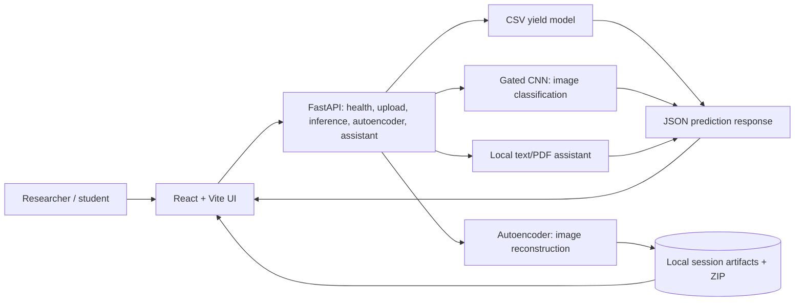

# Computational Lithography AI

**Prototype machine-learning workbench for exploring semiconductor lithography data.** The repository combines a React interface, a modular FastAPI application and example models for CSV-based yield estimation, layout-image classification and image reconstruction.

> **Status:** Demonstration and research prototype — **not** a qualified semiconductor inspection system. Synthetic inputs, lightweight models and local compatibility stubs are present. Do not interpret example outputs as verified wafer-fab performance.

## What is implemented

| Feature | Code location | Purpose |
| --- | --- | --- |
| Web interface | `computational_litho_ai/frontend/` | Uploads, predictions, reconstruction and assistant panels |
| REST API | `computational_litho_ai/api/` | Health and optional inference/assistant routes |
| CSV yield inference | `api/routes/inference.py` | Loads a CSV and returns per-row predictions from a saved model |
| Layout image classification | `api/routes/inference.py` | Preprocesses 64×64 grayscale images for the gated CNN |
| Image reconstruction | `api/routes/autoencoder.py` | Saves reconstruction files and a downloadable session ZIP |
| Document assistant | `api/routes/assistant.py` | Locally retrieves matching text from uploaded/sample documents |
| Example training and tests | `ml/`, `tests/` | Model demonstrations and basic tests |

The assistant routes include **local keyword-based document retrieval**. They should not be described as a verified RAG/LLM production service.

## Architecture



For an expanded component and data-flow view, see [docs/architecture.md](docs/architecture.md).

## Get started locally

**Prerequisites:** Python, Node.js/npm and enough environment resources for PyTorch. This example uses a virtual environment and separates backend and frontend terminals.

```bash
git clone https://github.com/Dheeraj1301/litho_version2.git
cd litho_version2/computational_litho_ai
python -m venv .venv
# Linux/macOS: source .venv/bin/activate
# Windows PowerShell: .venv\Scripts\Activate.ps1
python -m pip install -r requirements.txt
python -m uvicorn backend.main:app --reload
```

The API is served at `http://127.0.0.1:8000`; interactive route documentation is typically at `http://127.0.0.1:8000/docs`.

In a **second terminal**, from `computational_litho_ai`:

```bash
cd frontend
npm ci
npm run dev
```

Vite usually opens at `http://localhost:5173`. The API allows that local origin in its CORS configuration.

### Example API checks

```bash
curl http://127.0.0.1:8000/health
# Or inspect http://127.0.0.1:8000/docs for the exact enabled routes.
```

Some routers are **imported optionally**: missing libraries, incompatible saved model files or other import failures can cause certain endpoints to be omitted without shutting down the entire API. Consult backend logs when a route is missing. The project's Python dependency file is not fully version-pinned.

### Tests

From `computational_litho_ai`, with pytest and required optional libraries installed:

```bash
python -m pytest tests -q
```

The tests are small smoke/unit checks and **do not** constitute industrial performance validation.

## Repository map

```text
computational_litho_ai/
├── api/                 FastAPI routes: health, inference, assistant, reconstruction
├── backend/             Compatibility entry point for the API app
├── frontend/            React/Vite web interface
├── ml/                  Gated CNN, autoencoder, yield-prediction models and trainers
├── agents/              Experimental assistant and helper tools
├── data/                Example/synthetic data and uploaded sample documents
├── utils/               Loaders, helpers and synthetic data generation
├── tests/               Focused unit/smoke tests
└── requirements.txt     Python dependency list
```

## Known limitations and evaluation needs

- Several folders at repository root (`pandas/`, `httpx/`, `multipart/`) contain **compatibility stubs**. These can affect Python imports when running from the wrong working directory; the backend instructions above intentionally start inside `computational_litho_ai`.
- Saved model checkpoints and sample data are included, but a verified fab dataset, production evaluation procedure and measured defect-detection benchmarks are not documented.
- The example `run_pipeline.py` can train and predict on the **same sample records**; this is a demonstration, **not** an independent accuracy estimate.
- To make the project research-ready: document dataset provenance, implement clean train/validation/test partitions, record metrics against baselines, add pinned environments and test uploads end-to-end.

## Licence

[MIT](LICENSE).
