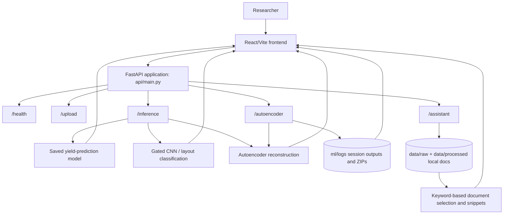
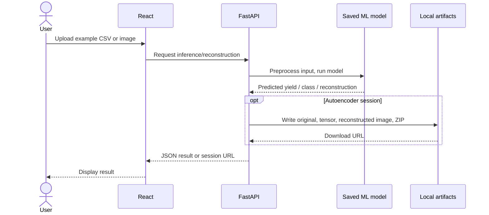

# Computational Lithography AI — Architecture

The repository contains a **React/Vite front end**, a **FastAPI back end** and several **local demonstration ML artifacts**. This is a prototype: components are built for research exploration rather than production fab operations.

## System diagram

## Example workflows

## Operational notes

- The backend mounts route modules **conditionally** via `optional_route`. When a module fails to import, unrelated routes remain available and logs record the omission.
- The startup working directory matters because inference loads checkpoints relative to `computational_litho_ai`.
- The local assistant uses document snippets and basic keyword scoring; support for PDF extraction depends on optional packages.
- `run_pipeline.py` is an example data/model demonstration, not a validated experimental benchmark. Reported performance requires independent held-out evaluation.
- The root contains lightweight compatibility stub directories, and many dependencies are unpinned; document the exact tested environment before external reproduction.

[Return to project README](../README.md).
